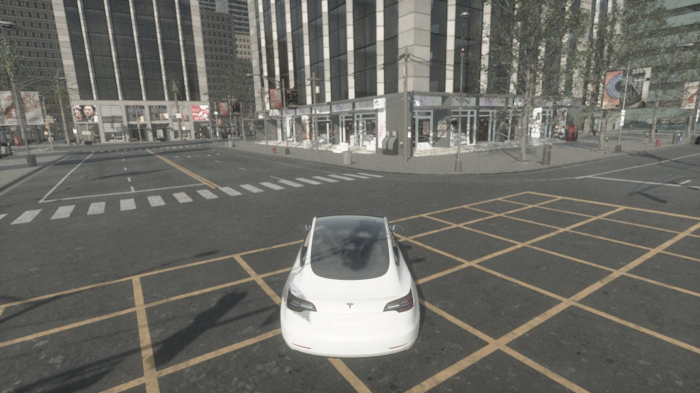

# CARLA 1.0 on the home server

18 November 2026. Follow-up to [`2026-11-05-drone-sim`](../2026-11-05-drone-sim/README.md),
run the day after CARLA 1.0 was released (17 November 2026, Unreal Engine 5.8).

## Result in one paragraph

CARLA 1.0 **would not start** on the home server's RTX 3070 (8 GB) with NVIDIA
driver 550.127.05 (TrueNAS 24.10.2.4), and also failed on a second machine under
WSL2. After upgrading the server's TrueNAS to 25.10.8, which brought NVIDIA
driver **580.173.02**, it **started and ran**. A car on autopilot drove through
the Town10HD_Opt map with a 1280 x 720 camera at about **48 to 52 frames per
second**, using about 5.6 GB of memory and about 6 GB of the graphics card. The
likely cause of the earlier failure is the older driver; this was not proven
(two things changed at once: the driver and the operating system around it).

## Before: it did not start (driver 550.127.05)

- Image `carlasim/carla:1.0` (15.7 GB), run headless in Docker with the same
  graphics fix as the earlier test (`--gpus all`, `NVIDIA_DRIVER_CAPABILITIES=all`,
  the EGL `nvidia_icd.json` mounted at `/etc/vulkan/icd.d/`), command
  `CarlaUnreal.sh -RenderOffScreen -nosound -quality-level=Low`, memory capped
  at 10 GB.
- Every launch exited with code 1 after: "Vulkan device could not be created at
  the project's supported feature levels". Variants `-vulkan`, `-sm5`,
  `-ForceFeatureLevelES31` and `-vulkan -dx11` failed the same way; not out of
  memory.
- **Second machine** (atlas: RTX 2080, Windows driver 610.88, WSL2 Docker): the
  same exit within seconds. Probable reason, not proven: WSL2 gives containers
  CUDA and Direct3D 12 but no NVIDIA Vulkan driver. Image removed afterwards.
- Epic's hardware page (shown for Unreal Engine 5.9, not 5.8) gives no minimum
  NVIDIA driver number.

## The upgrade

TrueNAS can only get a newer NVIDIA driver with a whole-system upgrade. With the
owner's go-ahead: configuration backup, then 24.10.2.4 to 25.04.2.6 (driver
550.142, still too old) and a reboot, then to 25.10.8 (driver 580.173.02, from
the 580 long-term-support branch; 25.10 uses NVIDIA's open kernel modules, which
support Ampere cards like the 3070) and a second reboot. After each reboot the
pools were healthy and about 50 containers came back by themselves; the Docker
service did not need a restart. ZFS pools were not upgraded. The process is in
the `truenas-update` skill. Two containers of a Supabase stack (studio and kong)
reported unhealthy after the reboots and had also been unhealthy before the
second one; they were not investigated.

## After: it runs (driver 580.173.02, TrueNAS 25.10.8)

`setup/drive_test.py` (client 1.0 in a `python:3.10-slim` container beside the
server container, with the wheel taken from the CARLA image) was run three
times against the server:

| | Run 1 | Run 2 | Run 3 |
|---|---|---|---|
| Server and client version | 1.0 / 1.0 | 1.0 / 1.0 | 1.0 / 1.0 |
| Map | Town10HD_Opt | Town10HD_Opt | Town10HD_Opt |
| Server frames per second, car driving, camera 1280 x 720 | 47.8 | 52.4 | 50.0 |
| Camera frames received in 40 s | 1,912 | 2,094 | 2,000 |
| Frames saved (every 20th) | 95 | 104 | 99 |
| Distance the car drove in 40 s | 74 m | 90 m | 89 m |

Resource use (server container, `docker stats` and `nvidia-smi`): idle after
start, about 5.2 GB of memory and 4.2 GB on the graphics card; during driving
with the camera, 5.6 GB of memory and 6.0 GB on the graphics card, graphics
card 48% busy. Starting the server takes under a minute.

### What these numbers do and do not mean

- The **"idle" frame rate** the script also logged (about 6,300 per second) is
  the simulation ticking with no camera attached, so no pictures were drawn. It
  is not comparable with the 60 frames per second idle figure in the November 5
  report, which was with a renderer running, and is not used.
- **No drone.** CARLA-Air (the November 5 test) has not moved to CARLA 1.0, so
  this is a car with a camera on autopilot, not the drone flight. The 36 frames
  per second of November 5 and the 48 to 52 here are different workloads on a
  different engine (Unreal Engine 4.26 versus 5.8) and should not be compared.
- The car drove only 74 to 90 m in 40 s; it was not checked why (traffic or a
  light is likely). Distance is a sign it moved, not a measure of anything.
- Two runs, one machine, quality level Low. Not tried: other quality levels,
  the ray-traced cameras, LiDAR, NuRec scenes, other maps.
- **A crash.** The first attempt called `load_world("Town10HD_Opt")` from the
  client; the server crashed with a segmentation fault (signal 11, log in
  `results/server-crash-1.log`) and the client timed out. Re-running without
  the explicit map load (the server already starts on Town10HD_Opt) worked
  twice. Cause not investigated; a map change at run time on an 8 GB card is a
  plausible trigger.

## For the owner

- The 15.7 GB image `carlasim/carla:1.0` and the `python:3.10-slim` image remain
  on the box (`docker rmi carlasim/carla:1.0`). The server container was removed.
- ZFS pool upgrade notices in TrueNAS are expected and were left alone.
- Keep the config backup in `/mnt/Storage2T/apps/truenas-upgrade-backup/`
  (contains secrets) and a copy off the box.
